<picture>
  <source media="(max-width: 720px)" srcset="assets/odd-hero-mobile.svg">
  
</picture>

**Dooopee.** Разрабатываю собственные продукты, проектирую интерфейсы и довожу небольшие детали до рабочего состояния.

Сейчас основной фокус — **ODD PRACTIC**: тренировки в Counter-Strike 2, в которых важно не просто повторять упражнение, а понимать, *какой навык ты отрабатываешь и что делать дальше*.

[ODD PRACTIC](#odd-practic) · [Другие проекты](#другие-проекты) · [Мой подход](#мой-подход) · [GitHub](https://github.com/Dooopee?tab=repositories)

---

## ODD PRACTIC

**CS2 / training hub / early development**

Хочу собрать в одном месте тренировочные карты, упражнения и понятную структуру занятий. Не набор случайных испытаний, а систему, к которой можно возвращаться: выбрал навык, потренировался, разобрал ошибки, повторил.

<picture>
  <source media="(max-width: 720px)" srcset="assets/odd-method-mobile.svg">
  
</picture>

Иллюстрация показывает проектируемую логику тренировок. Это не скриншот готового продукта.

**Что рассматриваю для развития проекта:**

| Направление | Зачем |
| :--- | :--- |
| **Aim / Reaction** | Отрабатывать первое наведение, точность и реакцию в повторяемых условиях |
| **Movement / Peeking** | Тренировать выходы, остановку перед выстрелом и работу с углами |
| **Recoil / Control** | Отдельно работать над контролем отдачи и стабильностью серий |
| **Practice flow** | Сделать выбор упражнения, повтор и переход к следующей задаче простыми и понятными |

**Текущий статус:** концепция и ранняя разработка. Репозиторий ODD-PRACTIC закрыт; публичной сборки и проверенных игровых режимов пока нет. Функции в таблице — направления работы, а не перечень уже реализованного.

<b>Как должна ощущаться тренировка</b>

Не хочу заставлять игрока разбираться в десятках экранов до первого выстрела. Хорошая сессия должна начинаться быстро.

1. Выбрать конкретный навык — не абстрактное «потренироваться».
2. Получить короткое понятное упражнение с ясным условием.
3. Повторить попытку без лишних переходов и ожидания.
4. Посмотреть на ошибки и решить, что именно менять в следующем подходе.

Интерфейс, подсказки и анимация должны помогать этому сценарию, а не отвлекать от него.

<b>Что важно в картах и режимах</b>

Читаемость целей и траекторий, предсказуемая логика рестарта, удобная настройка сложности, отсутствие визуального шума и стабильная работа в реальных игровых условиях.

Пока это требования к проектированию. Реализацию и игровые проверки буду отличать от идей.

---

## Другие проекты

### NEXEL

Независимый лаунчер Minecraft Java Edition для Windows. Отдельные игровые установки, работа со сборками и модами, настройка Java, скины и обновления.

[Репозиторий и документация](https://github.com/Dooopee/NEXEL) · [Релизы для Windows](https://github.com/Dooopee/NEXEL/releases) · [Обратная связь](https://github.com/Dooopee/NEXEL/issues)

Выше — настоящий экран NEXEL, а не концептуальный макет. Актуальные возможности и ограничения описаны в репозитории.

---

## Мой подход

**Функция не готова, если она только выглядит готовой.**

Проверяю сценарии целиком: что происходит при первом запуске, при ошибке, при повторном нажатии, при пустом состоянии и при возвращении пользователя в приложение. Отдельно смотрю на скорость, читаемость и поведение интерфейса на небольших экранах.

В оформлении предпочитаю сдержанную типографику, чёткую иерархию и motion design, у которого есть причина. Без декоративных счётчиков, бессмысленных бейджей и анимаций ради анимаций.

**Работаю с:** TypeScript, JavaScript, Electron, Vite, HTML/CSS, SVG, Git и GitHub. В задачах по CS2 изучаю возможности игрового инструментария и проектирования тренировочных карт.

<b>Что для меня означает «готово»</b>

- Сценарий можно пройти от начала до конца, не попав в тупик.
- Ошибки и нештатный ввод обрабатываются явно.
- Пользовательские данные и уже работающие функции сохраняются.
- Изменение проверено, а ограничение не скрыто за красивым экраном.
- Интерфейс остаётся понятным без анимации и не ломается на мобильном устройстве.

---

**DOOOPEE / 2026** · Проекты развиваются поэтапно. Публичные материалы отделены от закрытой разработки.

[Все доступные репозитории](https://github.com/Dooopee?tab=repositories) · [Как устроено оформление профиля](docs/PROFILE-DESIGN.md)
