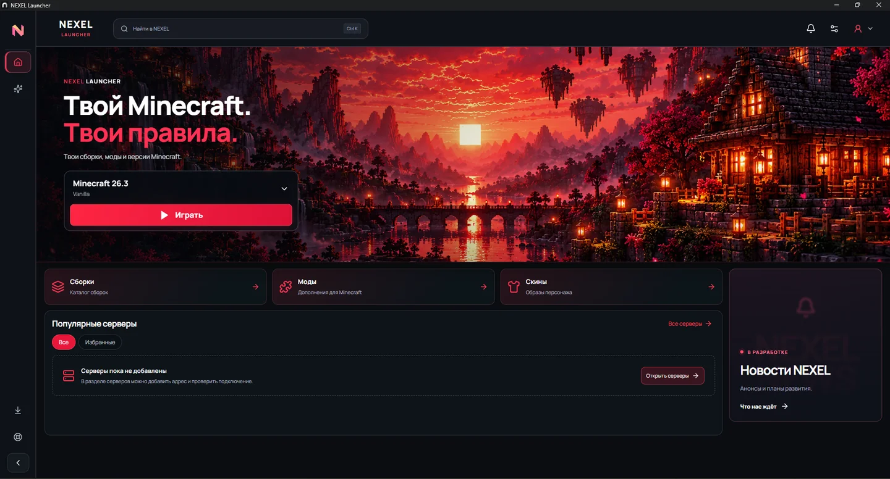

<picture>
  <source media="(max-width: 720px)" srcset="assets/odd-hero-mobile.svg">
  
</picture>

**Dooopee** / Independent development

Делаю собственные приложения, игровые инструменты и интерфейсы. Люблю проекты, в которых дизайн помогает человеку быстрее разобраться с задачей, а не отвлекает от неё.

**Сейчас в работе — ODD PRACTIC.** Хочу превратить тренировки в Counter-Strike 2 из набора разрозненных упражнений в последовательный процесс: выбрать конкретный навык, отработать его, понять ошибки и вернуться к повторению.

[О проекте](#odd-practic) &nbsp;·&nbsp; [Что планирую](#направления-работы) &nbsp;·&nbsp; [Как разрабатываю](#подход-к-разработке) &nbsp;·&nbsp; [NEXEL](#nexel) &nbsp;·&nbsp; [Репозитории](https://github.com/Dooopee?tab=repositories)

---

## ODD PRACTIC

**Counter-Strike 2 / тренировочные карты и инструменты**

Мне интересна не просто карта с мишенями и бесконечными ботами. Гораздо важнее, чтобы у игрока была понятная причина начать упражнение — и конкретный ответ на вопрос, что стоит потренировать после него.

Начинать с одной задачи, не теряться в настройках, быстро повторять попытки, видеть собственные ошибки. Именно вокруг этого строится концепция ODD PRACTIC.

<picture>
  <source media="(max-width: 720px)" srcset="assets/odd-method-mobile.svg">
  
</picture>

Схема объясняет задуманную механику занятий. Это не скриншот готовой игры и не демонстрация реализованной аналитики.

### Направления работы

| Область | Задача | На что буду обращать внимание |
| :--- | :--- | :--- |
| **Aim & reaction** | Первое наведение, смена цели, реакция | Постоянство условий и понятный перезапуск |
| **Movement** | Контр-стрейф, выходы из-за углов, остановка перед выстрелом | Контроль движения и ясные условия попытки |
| **Recoil** | Стабильность контроля отдачи и серий | Повторяемость упражнений без лишнего интерфейса |
| **Practice UX** | Выбор и повтор тренировок | Минимум переходов, предсказуемое управление |
| **Feedback** | Осмысленный разбор результата | Только показатели, которые действительно можно проверить |

**Статус проекта:** ранняя стадия. Репозиторий ODD-PRACTIC закрыт, публичной игровой сборки пока нет. Таблица выше — **планируемые направления**, а не готовые возможности.

<b>Как я представляю одну тренировочную сессию</b>

1. **Выбор.** Игрок сразу видит, чему посвящено упражнение и какие у него условия.
2. **Попытка.** Всё внимание остаётся на тренировке. Интерфейс не перекрывает игру и не заставляет постоянно открывать меню.
3. **Повтор.** Быстрый и предсказуемый рестарт без лишних экранов.
4. **Разбор.** Обратная связь должна отражать реальные игровые события. Никаких нарисованных оценок и фиктивного «прогресса».
5. **Следующее действие.** Повторить упражнение, изменить параметры или перейти к следующему навыку.

Это целевой пользовательский сценарий, который предстоит реализовать и проверить в игре.

<b>Что считаю важным для тренировочной карты</b>

**Управление:** понятные команды, быстрый сброс попытки, явные состояния старта и завершения.

**Читаемость:** достаточный контраст игровых объектов, стабильная ориентация на карте, отсутствие ненужных эффектов.

**Поведение:** предсказуемое появление целей, корректная обработка последовательных перезапусков, отсутствие зависания между попытками.

**Производительность:** без тяжёлого оформления, мешающего игровому FPS. Оценивать её нужно на реальной собранной карте, а не по макету.

### Порядок развития

| Этап | Что нужно получить | Условие перехода |
| :--- | :--- | :--- |
| **01 · Основа** | Чёткая модель тренировочной сессии и требования к карте | Сценарий можно объяснить и проверить вручную |
| **02 · Игровой прототип** | Один завершённый тренировочный цикл | Запуск, попытка и рестарт реально работают |
| **03 · Удобство** | Настройки и понятная обратная связь | Нет тупиков и необработанных действий |
| **04 · Проверка** | Тесты стабильности и игрового поведения | Результаты подтверждены, ограничения записаны |

Это план работы, а не список завершённых этапов и не обещание сроков.

---

## NEXEL

**Minecraft Java Edition / Windows launcher**

Другой мой проект — независимый лаунчер Minecraft. Его задача — сделать управление игровыми установками, сборками и модами понятнее: меньше ручных действий, больше контроля над тем, что установлено и запускается.

[Репозиторий](https://github.com/Dooopee/NEXEL) &nbsp;·&nbsp; [Релизы](https://github.com/Dooopee/NEXEL/releases) &nbsp;·&nbsp; [Обсуждение ошибок](https://github.com/Dooopee/NEXEL/issues)

На изображении — опубликованный интерфейс NEXEL. Состав функций и текущие ограничения смотри в документации проекта.

---

## Подход к разработке

**Для меня хорошая функция — это работающий сценарий, а не красивая кнопка.**

Я стараюсь оценивать продукты не только по основному экрану. Важно, что произойдёт при ошибке, повторном действии, пустом результате, медленной загрузке, потере соединения или возврате пользователя через несколько дней.

**Технологии, с которыми работаю:** TypeScript, JavaScript, Electron, Vite, HTML/CSS, SVG, Git, GitHub и инструменты тестирования. Для ODD PRACTIC отдельно изучаю создание тренировочных сценариев и возможности инструментария CS2. Не называю непроверенный стек проекта готовой архитектурой.

<b>Дизайн и движение: что оставляю, а что убираю</b>

- Чёткая типографика вместо множества конкурирующих заголовков.
- Анимация, объясняющая смену состояния или помогающая ориентироваться.
- Компактная навигация, адаптация под маленькие экраны.
- Уважение к настройке **reduced motion**.
- Никаких фальшивых статистик, бесполезных бейджей и элементов, похожих на рабочие, но не выполняющих действия.

<b>Проверки перед тем, как считать задачу готовой</b>

- Реальный пользовательский сценарий от начала до конца.
- Необычные и ошибочные входные данные.
- Повторное и быстрое нажатие, возврат назад, отмена.
- Сохранность данных и отсутствие регрессий.
- Доступность, отзывчивость и поведение без анимаций.
- Подтверждённый результат теста вместо формулировки «должно работать».

---

**DOOOPEE / 2026**

Проекты развиваются последовательно. Публично показываю то, что можно обоснованно описать; закрытые наработки и планы отделяю от проверенного результата.

[Публичные репозитории](https://github.com/Dooopee?tab=repositories) &nbsp;·&nbsp; [Правила оформления профиля](docs/PROFILE-DESIGN.md)
