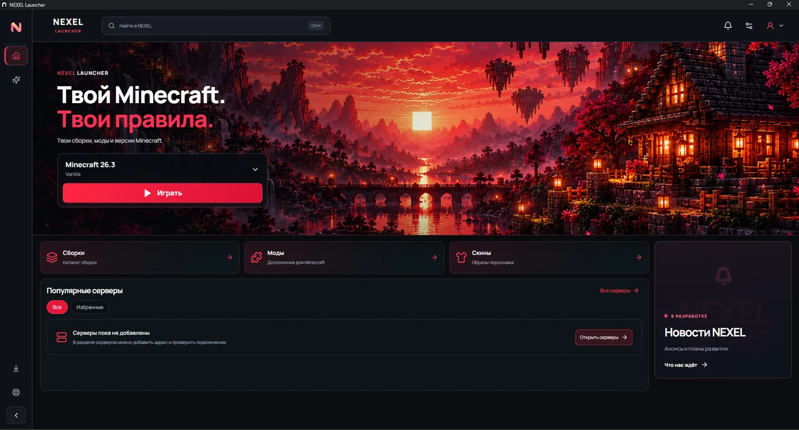
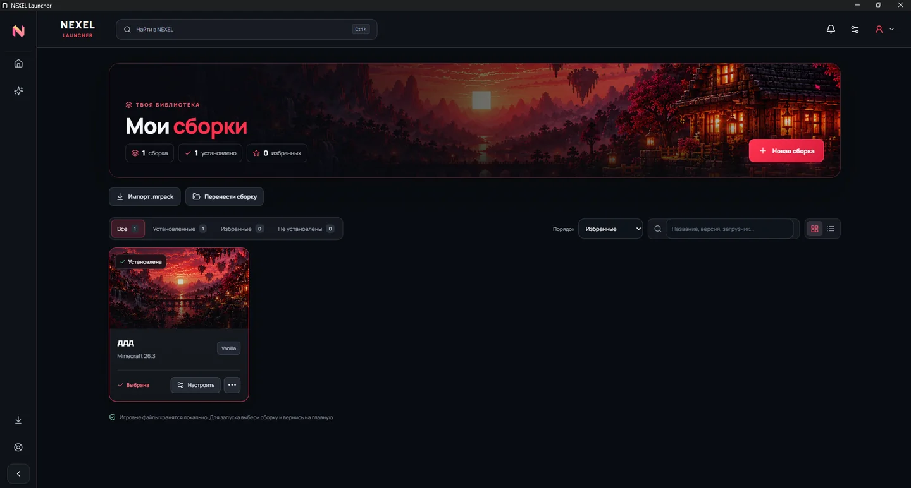
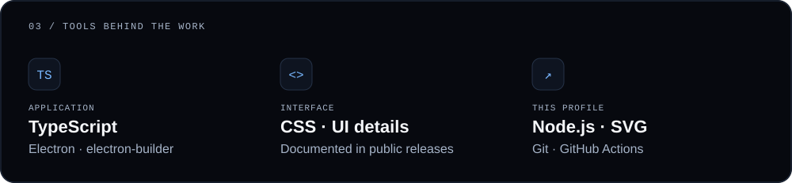
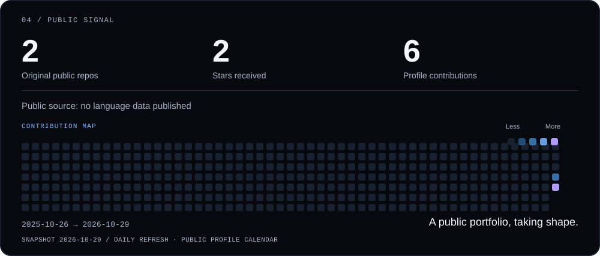
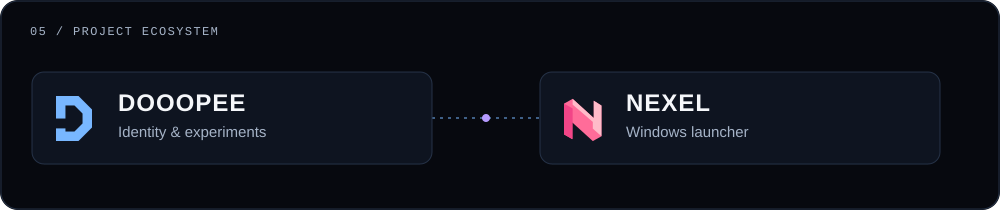
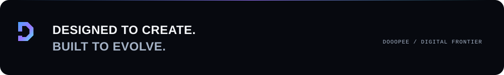

<<picture>
  <source media="(max-width: 1012px) and (prefers-reduced-motion: reduce)" srcset="assets/hero-mobile-still.svg">
  <source media="(prefers-reduced-motion: reduce)" srcset="assets/hero-still.svg">
  <source media="(max-width: 1012px)" srcset="assets/hero-mobile.svg">
  
</picture>

<samp>$ профиль → DOOOPEE &nbsp; / &nbsp; $ сейчас → NEXEL</samp>

Создаю собственные программные продукты, пробую новые технологии и уделяю внимание деталям, которые делают интерфейс удобным и приятным.

[Знакомство с NEXEL ↗](https://github.com/Dooopee/NEXEL) &nbsp; · &nbsp; [Скачать релиз](https://github.com/Dooopee/NEXEL/releases/latest) &nbsp; · &nbsp; [Публичные репозитории](https://github.com/Dooopee?tab=repositories)

 

## Главный проект

<a href="https://github.com/Dooopee/NEXEL">
<picture>
  <source media="(max-width: 1012px) and (prefers-reduced-motion: reduce)" srcset="assets/nexel-mobile-still.svg">
  <source media="(prefers-reduced-motion: reduce)" srcset="assets/nexel-still.svg">
  <source media="(max-width: 1012px)" srcset="assets/nexel-mobile.svg">
  
</picture>
</a>

**NEXEL** объединяет отдельные установки Minecraft, моды, скины и управление Java в одном интерфейсе.

| Твоё пространство | Что доступно |
| :--- | :--- |
| **Сборки** | Изолированные установки Vanilla, Fabric, Forge и NeoForge; импорт .mrpack |
| **Моды и Java** | Поиск Modrinth, установка зависимостей и автоматическая настройка Java |
| **Скины и обновления** | Локальная библиотека, предпросмотр в 3D и обновления с проверкой Ed25519 и SHA-256 |

Реальный интерфейс NEXEL из опубликованной владельцем галереи. Карточка выше — декоративная графика.

<!-- CURRENT:START -->
**Сейчас создаю — NEXEL.** Последний стабильный релиз: [v0.4.2](https://github.com/Dooopee/NEXEL/releases/latest), опубликован 2026-10-29.
<!-- CURRENT:END -->

[**Скачать NEXEL для Windows ↗**](https://github.com/Dooopee/NEXEL/releases/latest) &nbsp; · &nbsp; [История версий](https://github.com/Dooopee/NEXEL/releases) &nbsp; · &nbsp; [Сообщить об ошибке](https://github.com/Dooopee/NEXEL/issues)

Ещё один экран · возможности и планы

NEXEL ID пока хранится локально. Messenger, друзья, Studio и облачные интеграции находятся в разработке. Видимость скина зависит от игрового клиента и сервера. NEXEL — независимый продукт, не связанный с Mojang или Microsoft. Актуальные возможности и ограничения описаны в [документации](https://github.com/Dooopee/NEXEL#readme) и [примечаниях к релизу](https://github.com/Dooopee/NEXEL/releases/latest).

 

## Инструменты и подход

<picture>
  <source media="(max-width: 1012px) and (prefers-color-scheme: light)" srcset="assets/stack-mobile-light.svg">
  <source media="(max-width: 1012px)" srcset="assets/stack-mobile-dark.svg">
  <source media="(prefers-color-scheme: light)" srcset="assets/stack-light.svg">
  
</picture>

Инструменты приложения подтверждены публичными материалами NEXEL. Отдельно указаны технологии этого профиля.

 

## Публичная активность

<picture>
  <source media="(max-width: 1012px) and (prefers-color-scheme: light)" srcset="assets/metrics-mobile-light.svg">
  <source media="(max-width: 1012px)" srcset="assets/metrics-mobile-dark.svg">
  <source media="(prefers-color-scheme: light)" srcset="assets/metrics-light.svg">
  
</picture>

После включения Actions данные обновляются раз в сутки при изменениях. Учитываются собственные публичные репозитории без форков; звёзды суммируются по ним. Календарь соответствует публичному отображению GitHub и может включать обезличенные приватные вклады, если они включены в настройках. Языки описывают опубликованный код, а не закрытые исходники NEXEL.

[Посмотреть активность на GitHub ↗](https://github.com/Dooopee?tab=overview) &nbsp; · &nbsp; [Источники и методика](docs/MAINTENANCE.md#источники-данных)

 

## Экосистема проектов

<picture>
  <source media="(max-width: 1012px) and (prefers-color-scheme: light)" srcset="assets/ecosystem-mobile-light.svg">
  <source media="(max-width: 1012px)" srcset="assets/ecosystem-mobile-dark.svg">
  <source media="(prefers-color-scheme: light)" srcset="assets/ecosystem-light.svg">
  
</picture>

[DOOOPEE / айдентика](https://github.com/Dooopee/Dooopee) &nbsp; → &nbsp; [NEXEL / продукт](https://github.com/Dooopee/NEXEL)

 

<picture>
  <source media="(max-width: 1012px)" srcset="assets/footer-mobile.svg">
  
</picture>

[GitHub](https://github.com/Dooopee) &nbsp; · &nbsp; [Поддержка NEXEL](https://github.com/Dooopee/NEXEL/issues) &nbsp; · &nbsp; [Об оформлении](docs/DESIGN.md)
