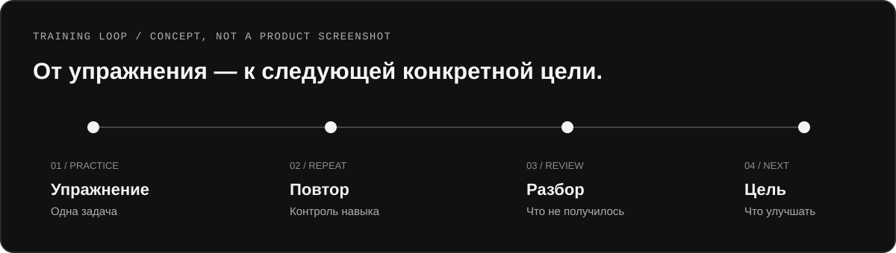

<picture>
  <source media="(max-width: 720px)" srcset="assets/odd-hero-mobile.svg">
  
</picture>

<samp>CS2 / PRACTICE MAPS / TRAINING FLOW</samp>

  <a href="#project">PROJECT</a> &nbsp; / &nbsp;
  <a href="#session-loop">SESSION LOOP</a> &nbsp; / &nbsp;
  <a href="#dev-notes">DEV NOTES</a>

---

## Project

**ODD PRACTIC** — тренировочный хаб для Counter-Strike 2. Карты, упражнения и короткие повторяемые сессии. Сейчас — закрытая разработка, без публичного билда.

`AIM` &nbsp; `MOVEMENT` &nbsp; `RECOIL` &nbsp; `PRACTICE UX`

## Session loop

<picture>
  <source media="(max-width: 720px)" srcset="assets/odd-method-mobile.svg">
  
</picture>

<b>DEV NOTES / раскрыть</b>

- **Делаю:** концепцию тренировочных сценариев, логику повторов и понятное управление.
- **Важно:** быстрый рестарт, стабильный FPS, минимум визуального шума.
- **Статус:** режимы и аналитика ещё не представлены как проверенные функции.

---

<samp>DOOOPEE / ODD PRACTIC / IN DEVELOPMENT</samp>

